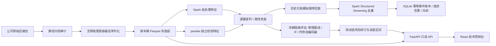

# 动力电池异常预警平台：工程与答辩方案

## 研究问题

从公开的车辆 BMS 充电片段中识别**车辆级异常**，并证明数据管道、模型评估、历史回放和告警状态处理可复现。数据集只有车辆级标签；不声称故障类型、真实提前预警天数或真实车载在线接入。

## 架构

本机开发采用 Docker Compose 运行 API 和看板，Spark 使用固定镜像本地 4 核运行。Spark local 模式验证了分布式计算框架的作业逻辑，但**不是多机器集群或云部署证据**。云端目标是对象存储保存 Parquet、容器服务运行 API、托管批处理和消息队列承接实时输入；要等云账号、预算与区域确定后逐项实测。

## 已完成的验收证据

| 关卡 | 结果 | 证据 |
|---|---|---|
| 原始数据安全 | GIS 123 个 pickle 静态审计；GIS 和 Figshare pickle 仅在受限容器中读取 | `reports/static_audit.json`, `docs/DATA_AUDIT.md` |
| 标准数据层 | 第二品牌 194,245 片段，24,863,360 采样行，无非有限值；保留源训练/测试分组 | `converted_figshare/brand2/manifest.json`, `features/brand2_manifest.json` |
| AI 评估 | 固定测试 18 车（7 异常）；三种方法、车辆级 Bootstrap 和低片段数敏感性分析 | `reports/brand2_comparison.json` |
| Spark 批处理 | local[4] 完成 24,863,360 行聚合，194,245 行输出，耗时约 98 秒 | `reports/spark_batch_results.json` |
| 批处理一致性 | Spark 与 pandas 194,245 键、50 列全部一致；最大绝对误差约 2.7e-13 | `reports/spark_parity.json` |
| 历史回放 | 74,862 唯一事件和 749 注入重复；去重后完整处理，待处理 0；重启计数不变 | `reports/stream_results.json`, `reports/stream_alert_audit.json` |
| 服务 | 只读 API、React/TypeScript 控制台、Nginx 同源代理、Docker Compose | `service/api.py`, `frontend/`, `compose.yaml` |

告警规则为训练正常片段电压差的 99 分位阈值、连续 3 次触发、随后冷却 20 段。测试回放产生 811 个告警事件，涉及 5/7 辆异常车和 3/11 辆正常车，误报不可接受。保留此负面结果作为阈值与工况建模改进的依据。

另有**终局车辆筛查**的探索性运行点：以训练正常车的车辆级分数 95 分位校准阈值，18 辆测试车上为 TP=5、FP=1、FN=2、TN=10，见 `reports/operating_point.json`。它需要整车已有片段，不能冒充实时告警；而且是在查看初轮测试结果后补做，必须标为探索性，后续需要新数据独立验证。

## 模型选择与实验纪律

1. 评估单元是车辆，片段标签和车辆标签不进入模型输入。第二品牌使用发布方固定车辆分组，训练模型仅用有片段的 22 辆正常训练车；深度模型另留 5 辆正常车选择训练轮数，再用全部 22 辆正常车重新拟合。
2. 每段 128 个采样点。Isolation Forest 用片段统计特征；时序卷积自编码器直接学习 128 点信号重建；物理基线为单体最高与最低电压差。片段分数按最高 5% 均值聚合为车辆分数。
3. 同一 18 辆测试车上，物理基线优于当前深度模型。**保留失败对照**，避免为追求技术栈而隐瞒结果。固定阈值只从正常训练车估计；测试组不用于调阈值。
4. 18 车样本量限制明显，Bootstrap 区间较宽。车辆 250 只有 5 片段，报告包含全部测试车及排除该车的敏感性结果。第三品牌的 100 车五折结果独立报告，不与第二品牌汇总成一个分数。

## 继续提高到可竞争的交付水平

1. **AI：**在训练车辆内部做工况条件化建模；比较规则、树模型、时序模型、物理约束模型，固定验证方案，做特征和损失消融。当前没有数据证据支持“深度模型更优”。
2. **流处理：**历史回放注入重复事件，验证去重、断点续跑、告警连续性和冷却；记录吞吐、延迟、误报车辆数。回放顺序由源片段编号构造，仅用于系统测试。
3. **工程：**加入可重复的镜像标签、数据版本哈希、模型元数据、运行日志、失败恢复和端到端验收脚本。将报告与演示绑定到确切的数据和代码版本。
4. **云端：**获得具体资源配置后部署到云对象存储与容器/托管计算服务，实测成本、吞吐、故障恢复和安全设置。没有账号与预算时仅交付可运行的本地栈与部署清单。
5. **答辩：**用“真实问题—数据风险—可验证架构—公平对照—失败分析—运行演示—局限”组织 PPT 和 3 分钟演示。国赛水平来自证据质量和完整工程闭环，不能由堆技术名词保证。
